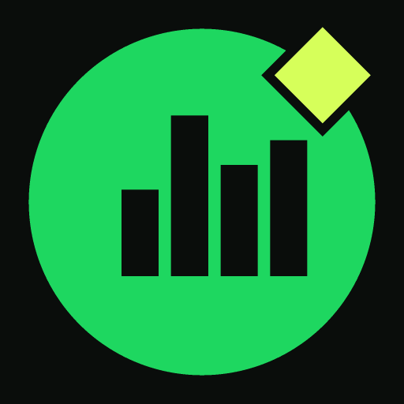
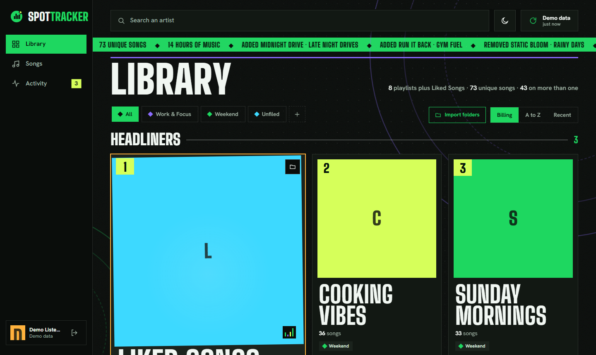
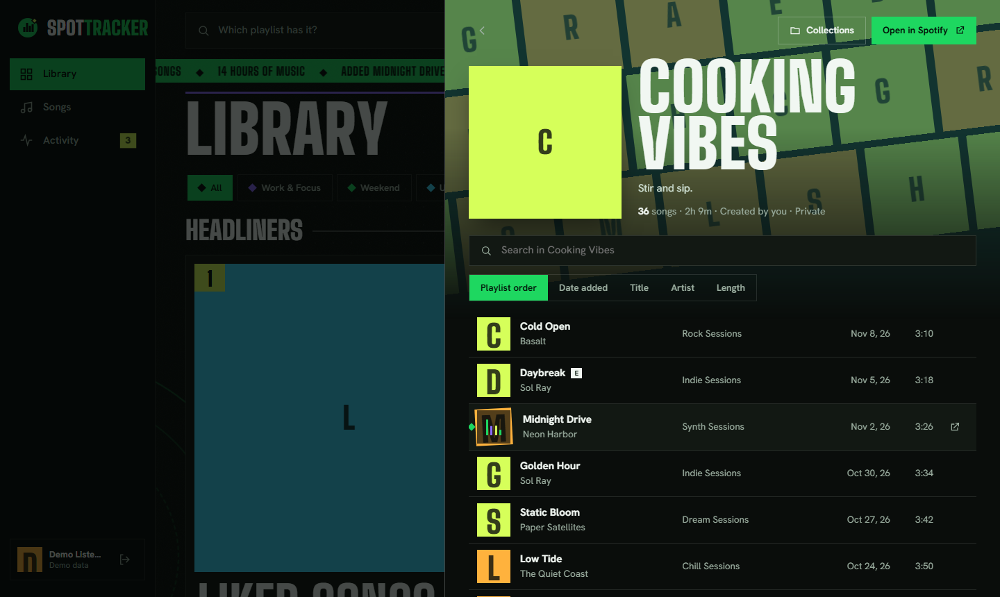
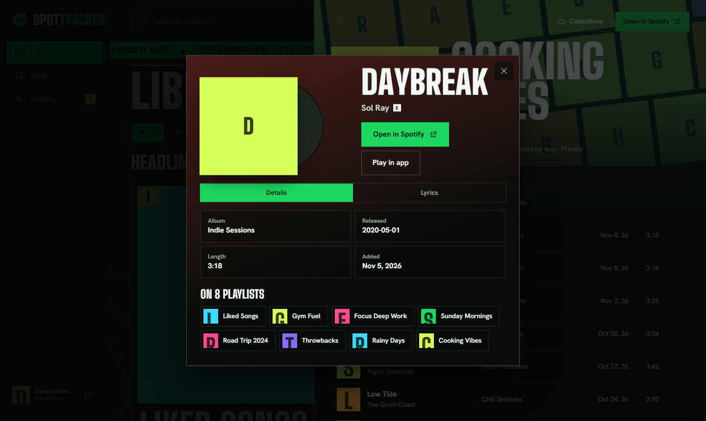
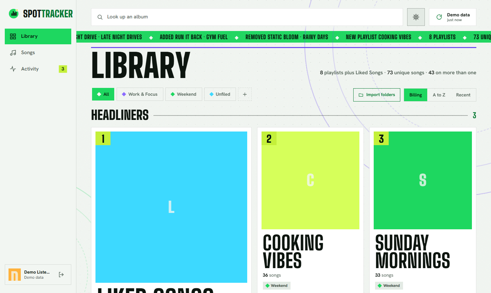
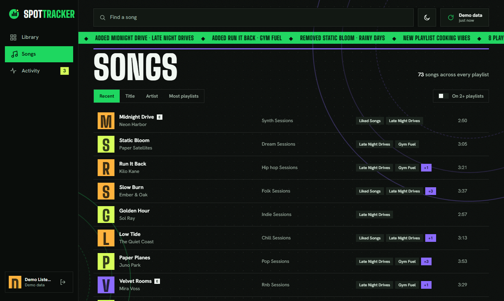
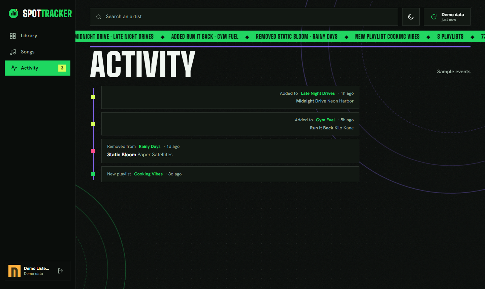
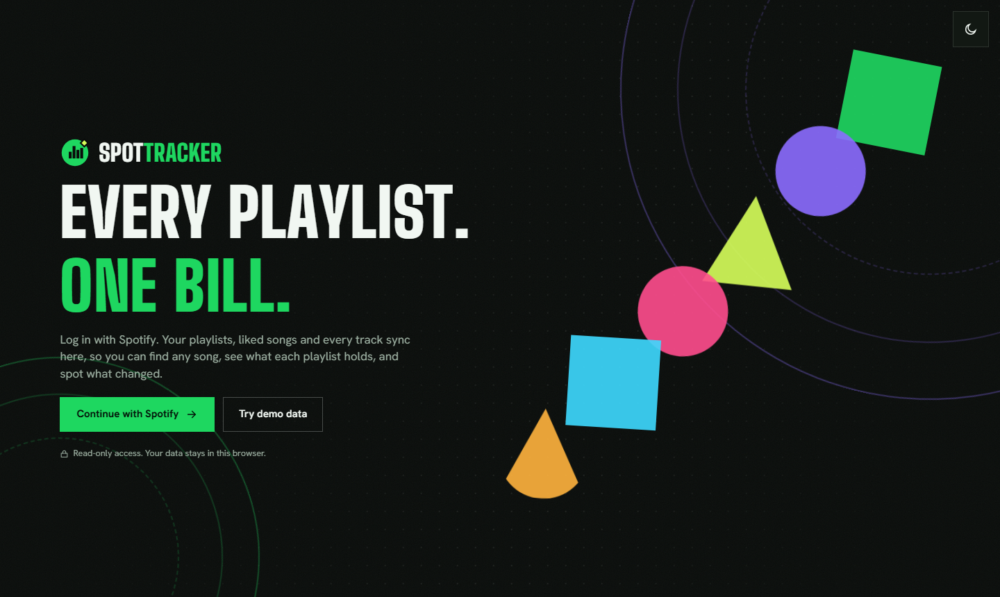
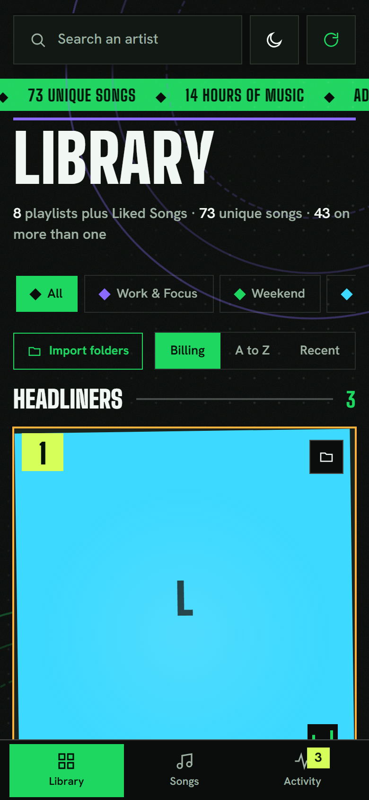
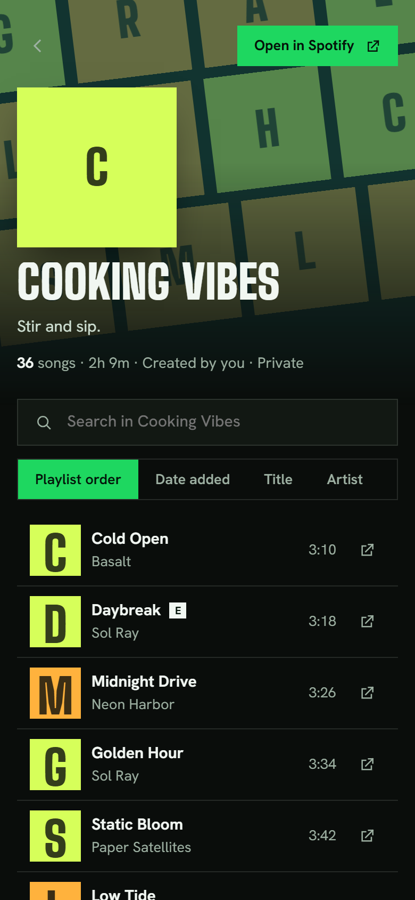

<p align="center">
  
</p>

<h1 align="center">SpotTracker</h1>

<p align="center">
  Every Spotify playlist, every song, one place. Log in with Spotify and your library is synced into a fast,
  animated web app you can search, sort, group into folders and install on your phone.
</p>

<p align="center">
  
</p>

> Screenshots use built-in demo data, not a real library.

## What it does

- **Sync your whole library:** playlists, Liked Songs and every track. Later syncs only re-read playlists that changed.
- **Find anything fast:** search songs, artists, albums and playlists at once. See which playlists a song is on.
- **See what changed:** an activity feed lists songs added or removed since the last sync.
- **Your own folders:** group playlists into collections. Paste your Spotify folder layout once with the importer.
- **Sort inside any playlist:** by playlist order, date added, title, artist or length, in either direction.
- **Lyrics and one-tap open:** read lyrics, then open the exact song in Spotify or the app.
- **Light and dark themes**, with a circular reveal when you switch.
- **Installable on your phone** as an app (PWA), with a bottom navigation layout.

## A look around

<table>
  <tr>
    <td width="50%"><br /><sub><b>Playlist view.</b> The playlist's own album covers drift behind the title. Sort bar above the songs.</sub></td>
    <td width="50%"><br /><sub><b>Song sheet.</b> Details, lyrics, the playlists it is on, and a button to open it in Spotify.</sub></td>
  </tr>
  <tr>
    <td><br /><sub><b>Light theme.</b> Same layout, off-white with a darker green for text.</sub></td>
    <td><br /><sub><b>Songs.</b> Every song across every playlist, with sorting and a 2+ playlists filter.</sub></td>
  </tr>
  <tr>
    <td><br /><sub><b>Activity.</b> A timeline of what was added or removed between syncs.</sub></td>
    <td><br /><sub><b>Welcome.</b> Log in with Spotify, or try the demo data.</sub></td>
  </tr>
</table>

<p align="center">
  
  &nbsp;&nbsp;
  
</p>

## Run it locally

You need [Node.js](https://nodejs.org) 20 or newer.

```bash
git clone https://github.com/shyanraphael/SpotTracker.git
cd SpotTracker
npm install
cp .env.example .env     # then add your Spotify Client ID (see below)
npm run dev              # http://127.0.0.1:5173
```

Click **Try demo data** on the welcome screen to explore without logging in.

## Connect your Spotify (one time, about 2 minutes)

1. Open https://developer.spotify.com/dashboard and **Create app** (any name).
2. Under **Redirect URIs** add exactly `http://127.0.0.1:5173/` (use `127.0.0.1`, not `localhost`).
3. Tick **Web API**, save, then copy the **Client ID**.
4. Put it in `.env` as `VITE_SPOTIFY_CLIENT_ID=<your id>` and restart `npm run dev`.
5. Click **Continue with Spotify**. Sync starts automatically.

Login uses the PKCE flow, so there is no client secret and no backend. Your tokens and synced library stay in your
browser (localStorage and IndexedDB). Access is read-only: `user-library-read`, `playlist-read-private`,
`playlist-read-collaborative`.

A new Spotify app starts in *development mode*: only people you add under **User Management** in the dashboard
(up to 25) can log in.

## Import your Spotify folders

Spotify does not share playlist folders with apps, so SpotTracker has its own collections. To copy your folder
layout, open Library, then **Import folders**, and paste one block per folder: the folder name followed by a colon,
then its playlists indented underneath.

```
Artists:
  Playlist name
  Another playlist name
Mixes:
  https://open.spotify.com/playlist/<id>
```

Names are matched ignoring capitals, punctuation and emoji. Playlist links match exactly. A preview shows what
matched before anything is saved. Collections are stored in your browser, so import again on each device.

## Host it for free

It is a static site, so any static host works. With Netlify:

1. Push this repo to GitHub, then in Netlify choose **Add new site, Import an existing project** and pick the repo.
   The build settings come from `netlify.toml`.
2. Add the environment variable `VITE_SPOTIFY_CLIENT_ID` with your Client ID, then deploy.
3. In the Spotify dashboard add your site address as a redirect URI, with `https://` and a trailing slash,
   for example `https://your-site.netlify.app/`.

**Vercel** works the same way: import the repo at https://vercel.com/new (it detects Vite on its own), add
`VITE_SPOTIFY_CLIENT_ID` under Environment Variables, and deploy.

Every push to `main` then redeploys automatically. GitHub Pages is not a good fit unless you use a custom domain,
because the app expects to live at the root of its address.

## Sync folders across devices

Your Spotify library always comes from Spotify, but collections (folders) are yours, so they are saved in a small
database and follow you to every device where you log in with the same Spotify account.

How it works: `api/sync.js` is a serverless function. The browser sends its Spotify token, the function asks Spotify
who it belongs to, and it reads or writes only that person's record. It stores a Redis record per Spotify user id.

To turn it on for your own deployment:

1. In Vercel open your project, go to **Storage**, and create an **Upstash Redis** database (free plan). Connect it
   to the project for Production and Preview. This adds `UPSTASH_REDIS_REST_URL` and `UPSTASH_REDIS_REST_TOKEN`
   (or the `KV_REST_API_*` equivalents) as environment variables automatically.
2. Redeploy. The account area in the app then shows "Synced across devices".

Without that database the app still works. It simply keeps folders on the current device ("Saved on this device"),
and the same happens when you run `npm run dev` locally. If two devices change folders at the same time, both sets are kept.

## How sync works

- The first sync reads all playlists plus Liked Songs. Later syncs only refetch playlists whose `snapshot_id` changed.
- Each re-sync compares old and new tracks and records additions and removals in **Activity**.
- Sync runs on login, with **Sync now**, and when you return to the tab after 5 minutes or more.

## Known limits

- **Folders:** Spotify's API does not expose them, so collections are made in the app and stored locally.
- **Playlists you do not own:** Spotify may refuse to return their tracks. Those show a "Limited" badge.
- **Lyrics:** Spotify has no lyrics API. Lyrics come from [LRCLIB](https://lrclib.net), so some songs have none.
- **Open in Spotify:** the main button opens the web link, which hands off to the app on most devices. *Play in app*
  uses the `spotify:` link.

## Built with

Vite, React, TypeScript and Framer Motion. Headings are set in Big Shoulders Display and body text in Hanken
Grotesk, both bundled with the app. Design notes live in `PRODUCT.md` and `DESIGN.md`.
